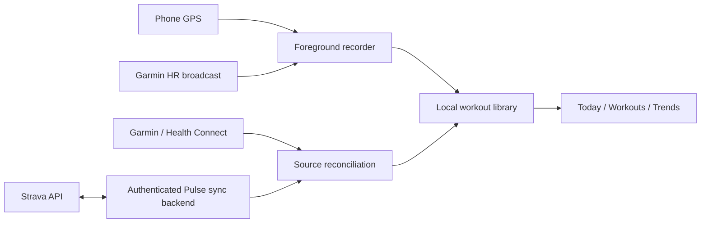

# Pulse 165: workout recording and Strava blueprint

Status: proposed implementation, 10 November 2026. No recording or Strava integration is implemented by this document.

## Product experience

Keep the current compact Today page. Add one Start workout action in Workouts and a small Resume workout banner across tabs while recording. Do not add another navigation tab.

Flow: Workouts → Start workout → choose sport → sensor readiness → Start → live session → Pause / Resume / Finish → review → Save.

First sports: outdoor run, walk and ride; indoor cardio and strength use duration and optional heart rate without GPS distance. Add a separate Log past activity form for title, sport, date, duration and optional distance/effort. Manual entries must remain visibly manual and never generate invented sensor samples.

The live screen shows a large elapsed timer, distance and pace/speed for outdoor sessions, a heart-rate zone ring, and one secondary chart. Large controls remain usable during exercise. Show GPS accuracy, HR connection and recording state explicitly. Missing HR displays a dash; lost GPS leaves a route gap. Keep display-on optional. Offer a simple local route preview initially; an interactive basemap is a later provider/cost decision.

Finish opens a review with route, splits, HR zones and effort check-in using existing workout components. Saving is local and works offline. Discard requires confirmation. Pause/resume are available from the ongoing notification; Finish opens review rather than deleting data. System Back leaves recording running and returns to the app with a visible recording banner.

## Scope and data ownership

| Source | Contribution | Limits |
|---|---|---|
| Phone recorder | GPS route, distance, speed/pace, timing, manual laps | Phone must accompany outdoor workout |
| Garmin broadcast HR | Optional live HR and session zones | Requires watch HR broadcast; does not remotely start a watch workout |
| Strava | Authorized activity summaries, available HR/pace/route streams and laps | Data availability varies; not a continuous live sensor or sleep/HRV feed |
| Garmin through Health Connect | Existing daily sleep, steps, recovery inputs and supported activity data | Preserve existing sync |

Do not estimate calories in the first recorder release. Show unavailable when absent; a future explicitly labeled estimate needs a documented model. Imported workout energy must not simply be added to Garmin's all-day calories.

## Android recording design

Introduce a service-owned RecordingRepository with StateFlow<RecordingState>; Compose and notification controls dispatch the same commands. Reuse BleFeed through a single shared sensor owner, avoiding a second competing Bluetooth connection or tracker.

State machine: Idle → Preparing → Recording ↔ Paused → Reviewing → Saved / Discarded. Interrupted is a recoverable state after process loss, reboot or permission loss. Persist transitions transactionally, reject duplicate Start/Finish commands, and permit only one active session.

Use monotonic elapsed time within a boot, separately storing wall-clock timestamps for charts. Persist pause intervals and checkpoints. After an interruption, present recovered data and Resume / Finish / Discard; never fill the missing interval with fabricated samples or silently resume after reboot. Bound potential sample loss with a short batch/checkpoint interval, initially five seconds, and flush on pause/finish.

Foreground recording starts from the visible Start action. Declare service types matching actual resources: location for GPS and connectedDevice for BLE; assess health type and its prerequisites for any sensor-only mode. The existing manifest has connectedDevice support, but fine location is currently limited to API 30 and must be updated for GPS recording. Request precise location only for outdoor recording, Bluetooth only for HR, and explain notification controls. No always-on background location request in the MVP. Use WorkManager for deferred sync, not the live timer. Verify supported Android versions and real-device screen-off behavior against Android's service restrictions before shipping.

Filter low-accuracy GPS points, impossible jumps and stale fixes. Preserve raw accuracy and accepted/rejected status for diagnostics; don't bridge long gaps for distance. Pause excludes distance and active duration. Begin with manual pause and laps; automatic pause can follow after field testing. Battery sampling should adapt conservatively without smoothing away real stops.

## Storage and app integration

Build on Workouts.kt (Workout and WorkoutCheckIn), WorkoutUi.kt, RunningUi.kt, Feeds.kt, HealthRepository.kt and Room v6 in Database.kt.

Proposed new tables:

- RecordingSession: UUID, sport, state, start/end, timing/checkpoint data and recovery status.
- RecordingSample: session ID, sequence, timestamp, coordinates/accuracy and nullable HR; indexed and batched, not one giant encoded string.
- RecordingInterval / RecordingLap: pause intervals and lap boundaries.
- WorkoutSourceLink: canonical workout ID, provider, athlete ID, remote ID, last revision and provenance.
- ProviderSyncState: connection status, cursors, last successful import and retry information. Strava tokens stay on the backend.

Finalize a recording into the existing workout presentation model transactionally; preserve raw session samples for details/export. Add explicit migrations and round-trip tests from v6. Split clear-imports operations by ownership: the current clearAllImports deletes every Workout, which must change before locally recorded workouts exist. Clearing Garmin or disconnecting Strava must not erase phone recordings or journal entries.

Initially keep phone session load in workout details, separate from daily strain. Before merging HR into daily scoring, add timestamp-based coverage reconciliation so overlapping Garmin, BLE and Strava samples cannot double-count cardiovascular load. Do not overwrite ConnectedDay with Strava activity totals or treat missing workout samples as a full day's coverage.

## Strava connection

Connect tab: Strava card with Connect, account, granted access, last sync, Sync now and Disconnect. Use the external browser/native authorization flow, never collect a Strava password. Start with activity:read; offer activity:read_all when the user wants Only You activities. Check granted scopes and gracefully handle partial consent. Do not request write access for imports.

Recommended architecture:

The backend holds the Strava client secret and encrypted athlete tokens. Use an authenticated per-user/device session, strict tenant isolation, expiring one-time OAuth state bound to that session, an allowlisted HTTPS callback, and a verified app link carrying only a short-lived completion code. Exchange and refresh tokens server-side; serialize refresh and atomically persist rotated tokens. Never put secrets in APK, Git, logs or callback URLs. Reject unbound callbacks and replayed completion codes.

Minimal backend endpoints: start authorization, OAuth callback, connection status, enqueue sync, fetch paginated normalized changes and disconnect. Webhook endpoint verifies subscription challenge, validates payload/owner mapping, acknowledges promptly and queues work; it never trusts a submitted athlete ID as client authorization. Require TLS, authenticated device access, encrypted storage and redacted diagnostics.

Import initial 30 days with progress and cancellation; older history is an explicit paginated request. Store provider IDs idempotently. Fetch summary lists first, then details/streams on demand or for selected recent workouts. Use returned time streams for sample timestamps, retain units, and tolerate unavailable HR/route/calorie data. Respect returned rate-limit headers and Retry-After when provided; back off on 429/5xx and refresh once on token expiry before asking to reconnect.

Webhooks cover supported activity creation/update/deletion and authorization changes. Queue idempotent jobs, fetch authoritative details, and retain a change cursor for the app. Reconcile a recent window on manual sync because webhook delivery is not a complete historical sync mechanism. Remove inaccessible/deleted Strava source data and invalidate affected caches; retain an independent Garmin/phone source if present. Disconnect revokes authorization and removes tokens; define and disclose deletion of cached Strava-derived data consistent with the API agreement.

Strava setup is an implementation dependency: developer application, appropriate account subscription/access capacity, client ID/secret in backend configuration, callback domain, HTTPS hosting and webhook registration. Current documentation describes single-player initial access and review/capacity requirements for broader distribution. Verify the actual developer dashboard and API agreement before release; no paid hosting or Strava purchase is authorized by this blueprint.

## Duplicate prevention

First match exact provider IDs; then propose cross-source matches using sport family, start-time proximity, duration overlap and distance tolerance. Initial candidate thresholds: start within two minutes, at least 80% interval overlap, distance within 5% when both have distance. Treat thresholds as tunable, not proof: require review for ambiguous/manual/multisport cases and allow unlinking.

Keep one canonical workout with multiple source links. Do not delete source records when linking or silently replace manual notes/check-ins. Prefer the original recording for its route/timing, use other source metrics only with visible provenance, and never sum duplicated distances or calories. A Garmin workout arriving via Health Connect, FIT and Strava should count once in workout totals.

## Delivery stages

1. Recorder foundation: migrations, manual entry, durable session state, timer, optional HR, pause/resume, save/recovery and notification controls.
2. Outdoor recording: GPS permissions/service, route and pace, manual laps, interruption handling and field validation. Ship the complete local recorder without waiting for Strava infrastructure.
3. Read-only Strava: backend authorization, 30-day import, source labels, duplicate reconciliation, missing-data states and disconnect.
4. Reliable sync: webhooks, remote edits/deletions, older-history import, rate-limit handling and device security tests.
5. Optional later: user-triggered Strava upload with activity:write, Health Connect export, auto-pause, audio lap cues and training targets. Upload is a separate opt-in action; guard against upload/import loops.

## Release acceptance

- Record outdoors for 60 minutes with screen off; verify usable GPS, HR gaps, battery consumption and persistent notification.
- Pause and resume repeatedly; paused intervals do not inflate distance, duration or load.
- Rotate, change tabs, lock phone, deny/revoke permissions, disable Bluetooth/location, interrupt process and reboot; no silently lost session or invented continuity.
- Save twice / receive duplicate callbacks without duplicate workouts; recover to the last persisted checkpoint.
- Import the same Garmin activity through three sources and count one workout, with reversible linking and intact check-in.
- Exercise OAuth rejection, reduced scopes, expired/rotated tokens, disconnected accounts, cross-user access attempts, 429, offline mode and duplicate/out-of-order webhooks.
- Remote deletion removes only the Strava contribution; clearing imports preserves local recordings.
- Test migration with existing workout/journal data, large text, screen reader labels and reduced animation settings.

## Official references

- [Android foreground service types](https://developer.android.com/develop/background-work/services/fgs/service-types) — service and permission design.
- [Strava authentication](https://developers.strava.com/docs/authentication/) — consent, scopes and token lifecycle.
- [Strava API reference](https://developers.strava.com/docs/reference/) — activity, stream and lap fields/endpoints.
- [Strava webhooks](https://developers.strava.com/docs/webhooks/) — supported events and queue-based handling.
- [Strava rate limits](https://developers.strava.com/docs/rate-limits/) — request budgeting.
- [Strava getting started](https://developers.strava.com/docs/getting-started/) — application registration and access prerequisites.
